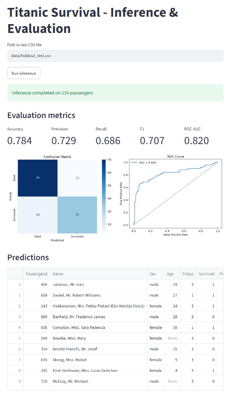
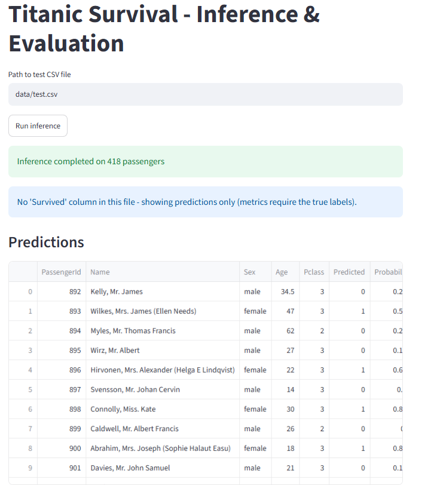
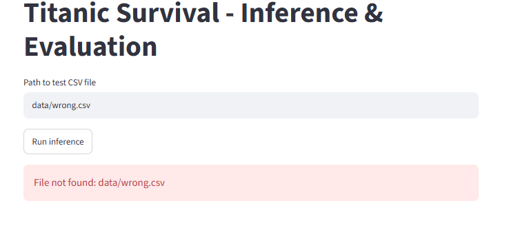

# Titanic Survival Classification

An end-to-end classification pipeline predicting Titanic passenger survival. The project covers the full machine learning lifecycle: fetching data directly from Kaggle, Exploratory Data Analysis (EDA), pre-processing, training a PyTorch model, and serving predictions via a Streamlit interface.

## Project Structure
```text
├── eda.ipynb               # Exploratory data analysis (Jupyter Notebook)
├── train.py                # Training script: fetches data, preprocesses, trains, and saves the model
├── ds_app.py               # Streamlit inference app: evaluates metrics and plots results
├── requirements.txt
├── data/
│   └── holdout_test.csv    # Held-out test set (134 passengers with labels) - generated by train.py
├── models/
│   ├── model.pt            # Trained model weights
│   └── preprocessor.joblib # Scaler, fill values, and feature list
└── screenshots/
```

## Setup
- Python 3.14
- Kaggle API token in `~/.kaggle/kaggle.json`, and join the [Titanic competition](https://www.kaggle.com/competitions/titanic)


## Installation
```bash
git clone https://github.com/EsterShmuel/titanic-survival-classification.git
cd titanic-survival-classification
pip install -r requirements.txt
```


## Run
EDA - open `eda.ipynb` and run all cells.

Train the model:
```bash
python train.py
```

Run the app:
```bash
streamlit run ds_app.py
```

## Example Usage
Once the Streamlit app is running, enter the path to a CSV file and click Run inference.

* **Evaluating the held-out test set** (includes `Survived` labels for full metrics and plots):


* **Predicting on Kaggle's `test.csv**` (no labels, outputs predictions only):


* **Robustness / Invalid Input** (handles errors gracefully):



### Architecture and Design Choices

Given the relatively small size of the Titanic dataset, my main goal was to keep the architecture simple and avoid overfitting, while building a clean, reproducible pipeline.

*   **Data Split & Leakage Prevention:** Since Kaggle's `test.csv` doesn't include ground-truth labels, I split the original `train.csv` into Train (70%), Validation (15%), and a Holdout Test set (15%). The holdout set is saved locally as `holdout_test.csv` and is used strictly for the Streamlit inference app. All preprocessing (like `StandardScaler`) is fitted **only** on the training set to prevent data leakage.
*   **Feature Engineering:** During EDA, I noticed that `Age` had many missing values. To help the model, I extracted `Title` from the passenger names (which helps infer age/status) and calculated `FamilySize`.
*   **Model Architecture:** I used a lightweight fully-connected PyTorch network (13 → 16 → 8 → 1) with ReLU activations and Dropout (0.2). I experimented with a deeper network, but it didn't improve performance and just started to memorize the training data.
*   **Handling Class Imbalance (The Recall Problem):** My initial baseline model had decent Accuracy but poor Recall—it learned that predicting "died" is usually a safe bet. To fix this, I applied a positive weight to `BCELoss` (after a sigmoid) to penalize the model more for missing actual survivors. 
*   **Training Strategy:** Instead of blindly taking the weights from the final epoch, the training script uses early stopping logic, saving the model state from the epoch that achieved the lowest validation loss.

**Final Holdout Metrics:** Accuracy: ~78%, Recall: ~69%, ROC-AUC: ~0.82.


